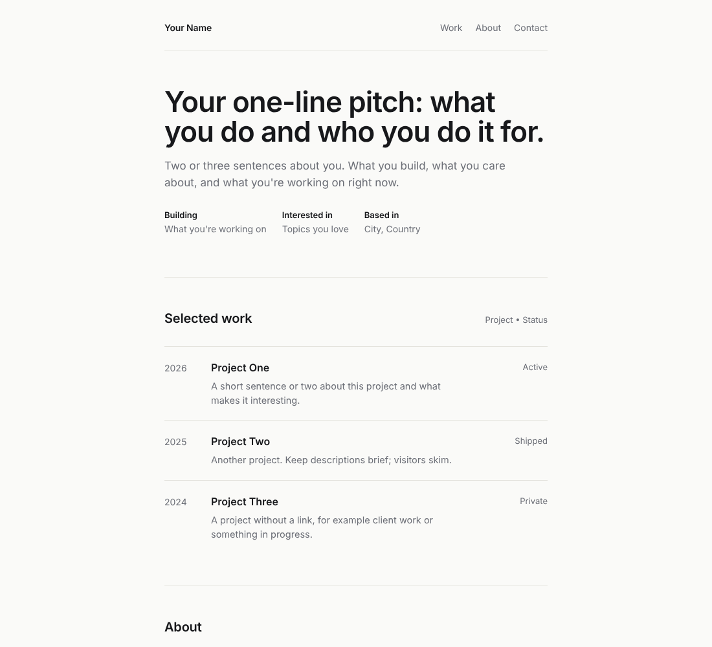

# Portfolio Template

A minimal, fast, single-column portfolio site. No build step, no frameworks, no dependencies. Just static files you can host anywhere.



## Make it yours in 3 steps

1. **Open `config.js`** in any text editor and replace the placeholder text with your own: name, headline, projects, about, contact links.
2. **Open `index.html`** in your browser to preview. Refresh after each save.
3. **Publish it** (see below).

That's all. `config.js` is the only file most people ever need to edit.

## Publish on GitHub Pages (free)

1. Click **Use this template → Create a new repository** at the top of this page.
   - Name it `your-username.github.io` to get the address `https://your-username.github.io`, or use any other name to get `https://your-username.github.io/repo-name/`. Both work.
2. Edit `config.js` right in GitHub (open the file, click the pencil icon, **Commit changes**), or clone the repo and edit locally.
3. In your new repo go to **Settings → Pages**. Under **Build and deployment**, choose **Deploy from a branch**, pick `main` and `/ (root)`, and **Save**.
4. Wait a minute or two. Your site is live at the address shown on that page.

Using a custom domain? Add it under **Settings → Pages → Custom domain**.

Prefer another host? Netlify, Cloudflare Pages and Vercel work by dragging in the folder or connecting the repo. No build settings needed.

## What you can customise in `config.js`

| Setting | What it does |
| --- | --- |
| `name`, `siteTitle`, `description` | Header name, browser tab title, search/social description. Also update the matching tags in `index.html` (see below) |
| `theme` | Five colours: background, text, secondary text, lines, accent |
| `googleFont` | Any [Google Font](https://fonts.google.com) name, or `""` for system fonts |
| `hero` | Headline, intro paragraph, and the small "Building / Interested in / Based in" facts |
| `work.items` | Your projects: year, title, link, description, tag. Add as many as you like. A small "3 projects" count shows by default; change or hide it with `work.label` |
| `about` | Paragraphs and a skills line |
| `contact` | Email and any number of social links |
| `footer`, `notFound` | Footer text and the 404 page copy. Write `{year}` in the footer to always show the current year |

**Before you publish:** open your site, press F12 and look at the **Console**. If any sample text from the template is still in `config.js` (`example.com` links, "Your Name", `20XX` years, "City, Country"), a warning lists exactly which fields to replace. Visitors never see it on the page itself.

**Hiding a section:** make its list empty (`work.items: []`, `about.paragraphs: []`, or no `email` and `links: []` in `contact`). The section and its nav link disappear automatically.

## Files

```
index.html   page shell (loads the files below)
404.html     "page not found" page (works from any URL depth)
config.js    YOUR CONTENT: edit this
style.css    design (edit if you want to change the layout or typography)
script.js    builds the page from config.js
LICENSE      MIT
docs/        README screenshot (safe to delete from your own copy)
```

## Other notes

- **404 page:** GitHub Pages, Netlify and Cloudflare Pages serve `404.html` for missing URLs automatically. It finds your site's folder by itself, so it works on `username.github.io`, `username.github.io/repo-name/` and custom domains with no changes. (Opening `404.html` straight from disk won't work; it needs a web server.)
- **Favicon:** a simple placeholder icon is built into both HTML files. Replace the `<link rel="icon">` line with your own image.
- **Analytics:** add your snippet inside the `<head>` of `index.html` and `404.html`.
- **Social previews:** link previews (X, Slack, Discord, iMessage) don't run JavaScript, so they read the `<head>` of `index.html` rather than `config.js`. Update the title, description and `og:`/`twitter:` tags there to match your name and description. To add a preview image, uncomment the `og:image` line, point it at a full `https://` URL (1200x630 px is ideal) and switch `twitter:card` to `summary_large_image`.

## Design notes

Single 640px column, soft off-white paper, one accent colour, subtle scroll-reveal that respects `prefers-reduced-motion`, and a mobile layout under 600px. Links are sanitised so only `http(s)`, `mailto` and relative URLs are accepted. Accessibility basics are built in: proper `nav`/`main`/`header`/`footer` landmarks, a skip-to-content link for keyboard users, visible focus outlines, generous tap targets, and a screen-reader hint on links that open in a new tab.

## Licence

[MIT](LICENSE): free to use, modify and share, for personal or commercial projects. Keep the licence notice if you redistribute the template itself; your own site built from it is yours.
